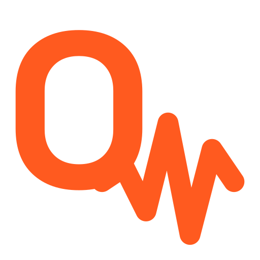

<p align="center">
  <picture>
    <source media="(prefers-color-scheme: dark)" srcset="assets/logo-dark.png">
    
  </picture>
</p>

<h1 align="center">agentQuake</h1>

<p align="center"><b>Chaos testing for AI agents.</b><br>
Break your agent before production does.</p>

<p align="center">
  <a href="https://github.com/saeedallam/agentquake/actions/workflows/ci.yml"></a>
  
  
  
  
  
</p>

<p align="center">
  <a href="#quick-start">Quick start</a> ·
  <a href="#scenarios">Scenarios</a> ·
  <a href="#mcp-tools">MCP</a> ·
  <a href="#roadmap">Roadmap</a> ·
  <a href="docs/adr">Design decisions</a>
</p>

---

agentquake sits as a proxy between an AI agent and the tools it calls. It
forwards each call to the real tool, injects faults defined in a YAML
scenario, and records every call as a trace, so you can see exactly how your
agent behaves when things go wrong.

> [!NOTE]
> Phase 1 (HTTP proxy, faults, YAML scenarios, traces) is complete. Phase 2
> (MCP) is in progress: the Streamable HTTP proxy works and stdio support is
> being built. The API may still change.

## Why

Agents look great in demos, where every tool answers instantly and
correctly. In production, APIs slow down, rate limit and time out. When that
happens, agents fail in ways that are hard to spot:

- **They loop**, calling the same failing tool again and again while the
  bill grows.
- **They give up** on the first timeout, even when one retry would have
  worked.
- **They claim success** after a call failed, and the user never finds out.

agentquake answers the question nobody tests: what does your agent do when
its tools fail?

## How it works

```
Agent  ──>  agentquake  ──>  Real tool
              │
              ├─ plans faults from the scenario (seeded, repeatable)
              ├─ applies them: delay, error status, or timeout
              └─ records a trace for every call, secrets redacted
```

Point your agent's tool base URL at the proxy instead of the real tool:

```
before:  https://api.weather.com/forecast
after:   http://localhost:3000/proxy/<runId>/weather/forecast
```

Nothing else in the agent changes.

## Quick start

Requirements: Node.js 22.12+, npm 11+ (npm 10.9 crashes while installing, see
[ADR 0001](docs/adr/0001-use-esm-and-vitest.md)), Docker with Compose.

```bash
git clone https://github.com/saeedallam/agentquake.git
cd agentquake
npm install                # also generates the Prisma client
cp .env.example .env
docker compose up -d       # PostgreSQL on 127.0.0.1:5433
npm run db:migrate
npm run start:dev          # API on http://localhost:3000
```

## Usage

```bash
# 1. A project and the tools your agent calls
curl -X PUT localhost:3000/projects/my-agent \
  -H 'content-type: application/json' -d '{"name":"My agent"}'
curl -X PUT localhost:3000/projects/my-agent/tools/weather \
  -H 'content-type: application/json' \
  -d '{"baseUrl":"https://api.weather.com"}'

# 2. A scenario
curl -X POST localhost:3000/projects/my-agent/scenarios \
  -H 'content-type: text/yaml' --data-binary @flaky-weather.yaml

# 3. A run (returns its id and proxy URL)
curl -X POST localhost:3000/projects/my-agent/scenarios/flaky-weather/runs

# 4. Point the agent at http://localhost:3000/proxy/<runId>/weather and run it

# 5. Read what happened, then close the run
curl localhost:3000/runs/<runId>/traces
curl -X POST localhost:3000/runs/<runId>/complete
```

### Demo data

`npm run db:seed` creates a `demo` project with four running runs against a
fake upstream on `http://localhost:5000`: `...0001` (no faults), `...0002`
(latency), `...0003` (http_error) and `...0004` (timeout). Seeding resets
their traces, so the fault pattern is the same every time.

## Scenarios

A scenario is a YAML file that says which faults to inject, where, and how
often.

```yaml
version: 1
name: flaky-weather
seed: 42 # same seed = same faults on the same requests

faults:
  - id: slow-forecast
    type: latency
    target: { tool: weather, path: '/forecast*' } # * matches any ending
    probability: 0.5 # 0 = never, 1 = always (default 1)
    config: { delayMs: 2000 }

  - id: rate-limited
    type: http_error
    target: { tool: weather } # no path = every path of this tool
    probability: 0.2
    config: { status: 429 }
```

Whether a fault fires is decided by the run's seed, the request number and
the fault id, so a run can be replayed exactly.

Invalid scenarios are rejected with every problem listed:

```json
{
  "error": "INVALID_INPUT",
  "issues": [
    {
      "path": "faults.0.probability",
      "message": "Too big: expected number to be <=1"
    }
  ]
}
```

### Faults

| Type         | What happens                              | Config            |
| ------------ | ----------------------------------------- | ----------------- |
| `latency`    | Waits, then calls the real tool           | `delayMs` (1000)  |
| `http_error` | Answers with an error, tool is not called | `status` (503)    |
| `timeout`    | Waits, then answers 504, tool not called  | `afterMs` (30000) |

Faults are plugins, so a new one can be added without touching the proxy or
the database schema. See [Contributing](#contributing).

## MCP tools

For an MCP server over HTTP, register the server endpoint as the tool's
`baseUrl` and point the agent at `/mcp-proxy/<runId>/<tool>`:

```
before:  https://weather.example.com/mcp
after:   http://localhost:3000/mcp-proxy/<runId>/weather
```

Only `tools/call` requests can get faults; everything else passes through
untouched. Target a tool by its MCP name with `path`:

```yaml
target: { tool: weather, path: 'get_*' }
```

When a fault fires, the agent receives a normal MCP tool result with
`isError: true`, so the model sees that the tool failed. See
[ADR 0005](docs/adr/0005-mcp-http-proxy.md).

## Roadmap

- [x] **Phase 1: HTTP proxy.** Seeded faults (latency, HTTP errors,
      timeouts), YAML scenarios, traces with secrets redacted
- [ ] **Phase 2: MCP.** Streamable HTTP proxy is done, stdio is in progress
- [ ] **Phase 3: Scoring.** Repeated runs in the background, evaluators for
      loops, retries, cost, false success and prompt injection, and a report
      with a score
- [ ] **Phase 4: Tooling.** A CLI (`npx agentquake run`), a GitHub Action
      that fails the build when the score drops, and a dashboard

## Development

| Script               | What it does                               |
| -------------------- | ------------------------------------------ |
| `npm run start:dev`  | Start the app and restart on file changes  |
| `npm test`           | Unit tests                                 |
| `npm run test:e2e`   | End-to-end tests (needs the database)      |
| `npm run lint`       | Lint (oxlint)                              |
| `npm run typecheck`  | Type check                                 |
| `npm run format`     | Format (Prettier)                          |
| `npm run db:migrate` | Create and apply migrations in development |
| `npm run db:deploy`  | Apply migrations (CI and production)       |
| `npm run db:seed`    | Load the demo data                         |

CI runs all checks and the end-to-end tests against PostgreSQL on every pull
request.

### Architecture

Decisions are recorded in [`docs/adr`](docs/adr). In short: the controller
translates HTTP, `ProxyService` orchestrates, fault planning and trace
redaction are pure functions, and database and network access live in small
infrastructure classes.

## Contributing

Conventions for humans and AI coding agents are in
[`AGENTS.md`](AGENTS.md). Commits follow
[Conventional Commits](https://www.conventionalcommits.org), and every pull
request must pass the checks listed there.

## License

[Apache-2.0](LICENSE)
